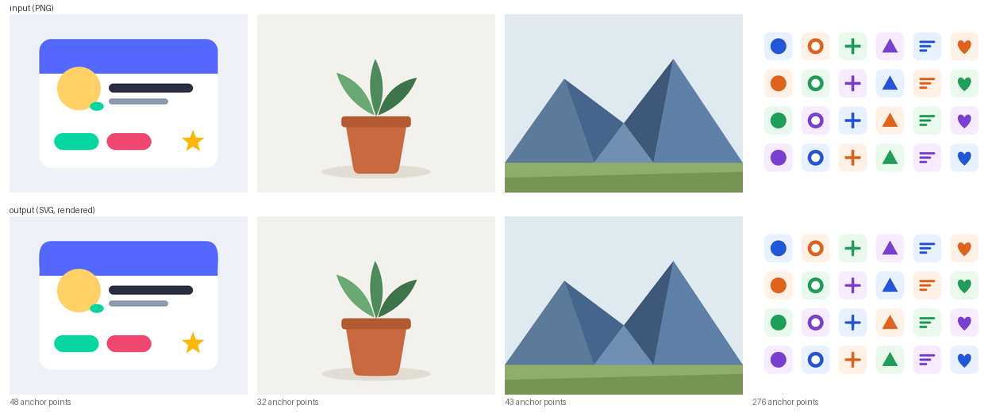

# vectorize-lab

Converts raster images (PNG, JPG) into editable SVG. It's aimed at flat
artwork: logos, icons, illustrations and UI.



Written in Python using numpy and Pillow. There's no ML model and it
makes no network calls.

## How it differs from other tracers

Most tracers reduce the image to a few colours, trace the pixel edges as
a staircase, and then smooth that staircase back into curves. This one
reads the antialiasing on the edge pixels instead. A pixel that is 30%
red and 70% white tells you the edge passes 30% of the way through it,
so edges can be placed to a fraction of a pixel before any curve fitting
happens.

Other things it does:

- works out the colour palette from the image, so there's no colour count to set
- layers shapes the way you'd draw them (a sky is one rectangle behind the
  hills, not a shape with a hill-shaped hole), so each shape is a single
  outline and no gaps show between shapes
- uses the fewest curves that stay within the tolerance, and outputs
  circles, ellipses and rectangles as real primitives where they fit
- writes lines of even width as a single centreline with a stroke
  width, rather than two outlines
- turns smooth colour ramps into linear and radial gradient fills,
  including glows that fade out to transparent
- keeps transparency: a transparent PNG gives an SVG with no background,
  and holes in shapes stay see-through
- copes with JPEG artefacts, and simplifies very detailed images so the
  output stays editable

Each stage is described in [docs/APPROACH.md](docs/APPROACH.md).

## Usage

```bash
pip install git+https://github.com/abby711/vectorize-lab
vectorize input.png -o output.svg
```

From a checkout, `pip install .` does the same, or run
`python3 vectorize.py input.png -o output.svg` without installing.

| Option | Default | What it does |
|---|---|---|
| `--tolerance` | 0.6 | how far a curve may stray from the traced edge, in pixels; higher means fewer points |
| `--max-colors` | 32 | upper limit on the detected palette |
| `--max-regions` | 6000 | above this, small regions are merged until the output fits |
| `--no-primitives` | off | always write paths instead of circles, ellipses and rects |
| `--workers` | 0 | processes to trace with; 0 is one per core |

From Python:

```python
from vectorlab import vectorize, Options

result = vectorize("input.png", Options(tolerance=0.8))
open("output.svg", "w").write(result.svg)
print(result.notes)   # e.g. when a detailed image had to be simplified
```

`Options(workers=0)` uses one process per core, as the command does.
The script calling it then needs its top-level code under
`if __name__ == "__main__":`.

There's also a small HTTP server:

```bash
python3 server.py
curl -X POST --data-binary @input.png http://127.0.0.1:8787/vectorize -o output.svg
```

## Results

I benchmarked it against VTracer 1.0 using SVG files where the original
drawing is known. Each SVG is rendered to PNG, traced by both tools, and
the output is compared with the original: how many anchor points it
needs, and how close its colours are to the input.

| | vectorize-lab | VTracer 1.0 `--simplify` |
|---|---|---|
| Anchor points, relative to the original drawing | 1.20× | 1.26× |
| Mean colour error (0–255) | 0.10 | 1.49 |

On nine real images from the web, it used fewer points and was more
accurate on six of them (illustrations, a cartoon mascot, an infographic).
VTracer was more accurate on the three heavily textured ones (an
engraving, graffiti and a stained-glass design), while using 3 to 9 times
as many points.

The full tables, the method and the ablation results are in
[docs/BENCHMARKS.md](docs/BENCHMARKS.md).

## Limitations

- It's slower than VTracer: a fifth of a second for a simple
  illustration, and up to about 15 seconds for a very detailed 1024 px
  image on a four-core machine.
- Dense texture (brushwork, engravings, stained glass) is traced
  approximately, and the result says so. VTracer is more accurate on
  those images.
- Gradients that overlap and blend into each other, or that aren't
  linear or radial, still come out partly as bands of flat colour.
- Lines that taper or change width, like brush strokes, stay as filled
  outlines. Lines that overlap where they meet can come out slightly
  kinked at the join.
- Partly transparent fills, like a soft shadow, come out either opaque or
  not at all, depending on whether they're more or less than half opaque.
  Edges do keep their partial transparency.
- Blurry or upscaled artwork, where edges are 2–3 px wide, picks up thin
  bands of in-between colour along the edges.
- Photographs aren't a good fit.

## Development

```bash
pip install -e ".[dev]"          # adds cairosvg and VTracer, for the tests and the benchmark
python3 tests/test_properties.py
python3 dataset.py               # render the fixtures
python3 compare.py --gt-only     # compare against VTracer
```

What's planned next is in [docs/ROADMAP.md](docs/ROADMAP.md).

[docs/BENCHMARKS.md](docs/BENCHMARKS.md) explains how to add your own SVGs
to the benchmark.
