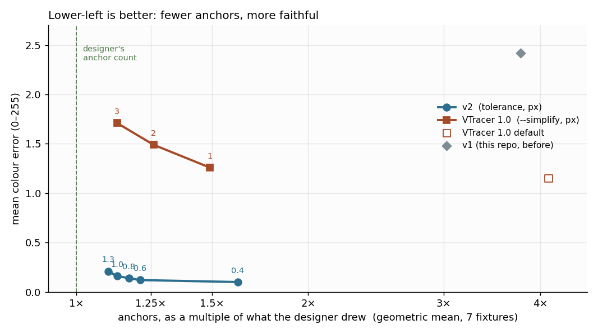

# How v2 works, and how it differs from VTracer

The job: turn a raster image into vector shapes that look the same,
use as few anchor points as possible, and edit the way a designer would
have drawn them. Those three goals pull against each other, so every
claim below is measured against ground truth — SVGs a designer actually
drew, rasterised, then traced back.

---

## The three pipelines side by side

| Stage | v1 (this repo, before) | VTracer 1.0 | v2 |
|---|---|---|---|
| Colours | k-means, you pick k | colour-precision bits + layer difference | **detected**: histogram peaks that have a solid interior, merge distance scaled to measured noise |
| Edge pixels | nearest colour | nearest cluster | **unmixed** as a blend of the two neighbouring colours |
| Small regions | dropped (left unpainted) | speckle filter | **merged** into the neighbour with the longest shared edge |
| Layering | flat tessellation | stacked image tree, no holes | stacked by enclosed area, holes filled, shapes **extended under** what covers them |
| Contour | pixel-grid staircase | pixel-grid staircase | **sub-pixel**, from antialiasing coverage |
| Staircase handling | Douglas–Peucker | signed-area inset/outset | none needed — there is no staircase |
| Where curves break | corners by angle | inflections + accumulated angle (greedy) | dynamic program: fewest segments within tolerance |
| Tangents at joins | Catmull-Rom | from smoothed polygon | **shared** at smooth joins, **free** at corners |
| Corners | turn angle | turn angle | turn angle, then **refined** to where the two sides meet |
| Shapes | paths only | paths only | circle, ellipse, rect, rounded rect where they fit |

---

## VTracer, from its own documentation

1. **Hierarchical clustering** builds an "image tree" of colour
   clusters, stacked so no shape has holes.
2. **Path walking** traces each cluster's outline on the pixel grid,
   merging consecutive steps in the same direction.
3. **Staircase removal** decides, using the signed area of each
   triangle along the path, whether to keep the inner or outer corner of
   every pixel step.
4. **Penalty simplification** greedily extends a run until a penalty
   proportional to deviation × length exceeds a tolerance, then replaces
   it with one line.
5. **Corner-preserving 4-point subdivision** smooths the polygon into a
   dense curve without rounding off detected corners.
6. **Splice points** are placed at inflections and wherever the
   accumulated turning angle exceeds a threshold.
7. Each piece between splice points goes to a Bézier curve fitter.

Version 1.0 adds `--simplify` (paper.js-style re-fitting with the fewest
cubics within a tolerance) and `--hierarchical cutout` (seam-free shared
boundaries).

It is well engineered and very fast. Its central assumption — start from
an integer pixel staircase and smooth it back into a curve — is the one
v2 drops.

---

## v2, stage by stage

### 1. Detect the palette instead of guessing k

Flat artwork has a handful of exact colours, each covering thousands of
pixels; antialiasing blends are spread thinly across many values. So the
palette comes from colour-histogram peaks, filtered by one test:
**a real colour has an interior.** Blends and compression ringing live
in bands one or two pixels wide and never have pixels whose four
neighbours are the same colour.

How close two colours may be and still count as different depends on
the image. A white card on a near-white page is 5.9 ΔE apart and both
are real; in a JPEG, 4 ΔE is noise. v2 measures noise as the mean
neighbour difference inside flat areas — 0.00–0.03 for clean
illustrations, 0.24–0.55 for JPEGs — and scales the merge distance by
it.

A colour that lies on the line between two other palette colours could
just be their blend, so it has to show a substantially larger interior
to be kept.

On the badge fixture this recovers the source's nine colours to within
one unit of their hex values, with no k supplied.

### 2. Label edge pixels as blends

An edge pixel between blue and yellow can sit nearer to green in colour
space. v1 called it green and grew a sliver. v2 explains each impure
pixel as a mix of two colours from its neighbourhood and assigns it to
whichever dominates.

### 3. Partition, merging never dropping

Every pixel belongs to exactly one region. Regions under the minimum
area are absorbed by the neighbour they share the most boundary with.
Unpainted holes become impossible rather than unlikely — the property
tests check it.

### 4. Stack like a designer

Shapes are painted largest enclosed area first, with their holes
filled. Anything inside a shape's hole is smaller, so it is always
painted on top: a ring becomes a disc with a smaller disc over it, and
every shape is one simple outline.

Then each shape **extends under the shapes painted after it**, within
its own convex hull. A designer draws the sky as a rectangle and paints
mountains over it; tracing only the visible sky gives an outline that
follows every ridge. The added area is always overpainted, so the
picture is unchanged.

Those hidden edges aren't colour edges in the image, so there is no
antialiasing to read there. Their geometry is known exactly — it is the
hull — so v2 renders the hull with analytic antialiasing and takes
coverage from that. Before this, the sky's hidden bottom edge came out
as a one-pixel staircase costing a dozen anchors.

### 5. Sub-pixel contours from antialiasing — the central idea

An edge pixel that is 30% red and 70% white records where the edge
crossed it. Quantising throws that away; both v1 and VTracer trace the
resulting integer staircase and then try to smooth it back.

v2 unmixes every boundary pixel between the colour inside and the colour
across the edge, giving its coverage, and runs marching squares on that
field. Where the step is axis-aligned, the crossing uses the exact
box-filter relation (coverage = 0.5 + distance from the pixel centre).
Coverage is clamped either side of 0.5, so the contour's topology is
exactly the hard mask's — positions move, connectivity never does.

Because A's coverage against B is one minus B's against A, two
neighbouring regions trace the *same* curve along their shared edge.

Measured on a rendered circle: mean radial error falls from **0.191 px
to 0.030 px** — 6.4× more accurate than tracing the hard mask.

### 6. Corners, put back where they were

Rendering shaves a sharp corner into a short chamfer, and a corner
detector lands on one end of it. v2 fits a line to each side and moves
the anchor to where they intersect. A rectangle drawn at
(40.4, 52.2)–(150.4, 132.2) comes back at exactly those coordinates.

### 7. The fewest curves that stay within tolerance

Each contour splits at its corners into runs. Along each run, candidate
breakpoints come from a fine Douglas–Peucker polygon. Every span between
two candidates is fitted with a cubic (or a line), all spans in one
vectorized pass, and a dynamic program picks the breakpoint set with the
fewest segments whose fits all stay within tolerance.

Tangents are estimated once per breakpoint by local quadratic regression
and shared by both segments meeting there, so smooth joins are smooth by
construction. At a corner the tangent is left free and solved for with
the control points — a sharp tip has no well-defined tangent to
estimate, and guessing one cost the leaf fixture three extra anchors.

Closed smooth loops have to start somewhere, and that point is forced to
be an anchor. v2 tries the loop's leftmost, topmost, rightmost and
bottommost points — where designers put anchors — and keeps the
cheapest. An ellipse comes back with its four anchors exactly on its
extrema.

### 8. Shapes designers actually draw

If a contour fits a circle, an ellipse (Halíř–Flusser fit, any
rotation) or an axis-aligned rectangle with the best corner radius,
v2 emits the primitive. A tilted ellipse drawn at 30° comes back at
30.0°; a pill with `rx="17"` comes back with `rx="17"`.

---

## Results

Seven ground-truth fixtures — flat scene, brand mark, UI badge, low-poly
mosaic, organic blobs, potted plant, weather icons — each an SVG drawn by
hand, rasterised at 480×360.

| Engine | × designer's anchors | Mean colour error | Worst agreement |
|---|---|---|---|
| **v2** (tolerance 0.6) | **1.21×** | **0.12** | **99.8%** |
| v2 (tolerance 1.0) | 1.13× | 0.16 | 99.8% |
| VTracer `--simplify 2` | 1.26× | 1.49 | 98.5% |
| VTracer `--simplify 3` | 1.13× | 1.71 | 98.5% |
| VTracer default | 4.10× | 1.15 | 99.1% |
| v1 | 3.77× | 2.42 | 98.4% |

At every operating point v2 is both leaner and more faithful. Matched
for compactness — v2 at 1.0 px and VTracer at `--simplify 3` both land at
exactly 1.13× — v2's colour error is **0.16 against 1.71**. Even v2's loosest setting is more
faithful than VTracer's tightest.

On inputs without ground truth the gap is larger where the input is
messier: the mushroom JPEG takes 589 anchors at 97.4% agreement against
VTracer's 2,988 at 94.5%; the logo-mark JPEG 231 against 663.

### What each idea was actually worth

Each idea switched off on its own:

| Switched off | × designer | Mean error | Contribution |
|---|---|---|---|
| — (full v2) | 1.21× | 0.12 | |
| sub-pixel coverage | 2.34× | 0.12 | **−48% anchors** |
| stacking with holes filled | 1.92× | 0.19 | −37% anchors, and fidelity |
| blend-aware labels | 1.45× | 0.12 | −17% |
| extending under occluders | 1.29× | 0.14 | −6% |
| optimal fit (greedy instead) | 1.23× | 0.14 | −2% |
| primitives | 1.18× | 0.14 | +3% |

Two of these deserve plain reading.

**Global optimality is worth 2%.** Once contours are clean and tangents
are shared, greedily taking the longest feasible span is already nearly
optimal. The dynamic program stays because it is cheap and never worse,
but it is not where the win comes from.

**Primitives cost anchors.** Under this metric a circle counts as 4
anchors, while the fitter draws a circle in 3 cubics. Their value is
that a circle stays an editable circle and a rounded rect keeps its
radius — not compactness.

The win comes overwhelmingly from two things: reading the antialiasing
instead of discarding it, and layering shapes the way designers do.

---

## Fail-safe properties

`tests/test_properties.py` checks invariants over seeded random scenes,
not just the fixtures:

| Property | How it's checked |
|---|---|
| No pixel left unpainted | Render the output over magenta and over green; any pixel that differs was uncovered. v2: **0.000%** on every seed. v1: 0.3–2.0%. v2 without stacking: 0.7–2.0%. |
| Faithful | Mean colour error under 1.0 on every random scene |
| Deterministic | Same input, byte-identical SVG |
| Valid | Every subpath closed; every output renders |
| Nothing dropped | Every pixel in exactly one region; no region undersized |
| Sub-pixel accurate | Traced circles within 0.1 px of the truth on average |
| Primitives exact | Circles recovered to within 0.3 px in centre and radius |
| Honest failure | Pure noise past the region cap is rejected, not traced |
| No regression | Every ground-truth fixture under 1.8× the designer's anchors |

---

## What complex and real images broke

The seven tidy fixtures flattered v2. Harder input found nine real
problems, each fixed at the cause rather than tuned around:

| Symptom | Cause | Fix |
|---|---|---|
| A 1440 px badge traced *worse* than the 480 px one (14 shapes, not 10) | Lanczos downscaling rings, painting false halos — and breaks the area-average assumption coverage relies on | Downscale with a box filter |
| 1.5 px stars disappeared | A fixed 10 px merge threshold treats every tiny region as noise | Merge size scales with measured noise: 4 px in clean art, 16 px in JPEG |
| Tiny sharp windows came out rounded | Antialiasing softens small corners, so a slightly rounded rect fit marginally best | Prefer the sharp rect whenever it fits |
| Designer-rounded corners came out sharp | Corner refinement sharpened every corner | A corner that bulges off its sides isn't a corner; it's dropped |
| Rotated rounded rects bowed | Curves were checked at 28 samples, and a corner between two samples went unseen | Chosen curves are verified densely; failures are ruled out and the search reruns |
| Neon gradients at 70% agreement | Continuous-tone input fell back to a fixed 12 colours | Colours are added until the average error is under 4 ΔE, up to 96 |
| An engraving read as two colours | Noise scaling inflated "pure colour" tolerance to 29 ΔE | Noise widens tolerances up to JPEG levels only |
| Detailed images refused outright | A hard region cap | A budget: merge harder until it fits, and say so |
| Pure noise measured as *clean* | The estimator looks at flat pixels, and noise has none | Fall back to the overall neighbour difference; noise past a threshold is refused |
| Brown fields came out green, yellow stamen tips green-centred | Small regions merged into the neighbour with the longest shared border, taking its colour | Merge into the neighbour whose colour is closest |
| Building windows vanished | Every region under the noise-scaled minimum merged, including high-contrast ones | A small region that stands out from all its neighbours is kept — unless it is a blend of two of them |
| A pink highlight rendered orange | Colours covering too little area never reached the palette, so their pixels took the nearest colour 30 ΔE away | Clusters of pixels their colour doesn't explain add a colour |
| A JPEG copy of clean art traced at ~20× the designer's anchors | JPEG stores colour at half resolution; the 3 px smear at every edge was read as shapes | For JPEG, blends reach 3 px; thin fringes that are mixes of their sides merge; patches whose average is a neighbour's colour merge |

Two performance fixes came out of the same work. Fitting batches every
candidate span from every contour in the image into a few large array
operations instead of one small batch per run (8,030 calls became 34).
Region merging became one exact greedy pass over the region adjacency
graph instead of relabelling the image each round (20.6 s to 1.6 s on
the graffiti).

### Real images

Nine web images at 1024 px, same input for both engines:

| Image | v2 anchors / error | VTracer anchors / error |
|---|---|---|
| Clip-art mushroom | **1,044 / 3.52** | 2,944 / 7.61 |
| Vector flower | **2,833 / 2.08** | 5,860 / 3.71 |
| Cartoon mascot | **6,320 / 4.22** | 11,191 / 4.98 |
| Isometric city infographic | **13,115 / 3.78** | 22,921 / 6.42 |
| Low-poly fox | **19,578 / 8.24** | 23,730 / 12.15 |
| Neon gradient blobs | **11,795 / 13.28** | 21,183 / 16.12 |
| Graffiti alphabet | 47,209 / 11.76 | 140,143 / **10.76** |
| Botanical engraving | 22,155 / 21.18 | 192,430 / **18.58** |
| Stained-glass peacock | 42,721 / 16.46 | 144,932 / **13.44** |

On illustration v2 wins on both counts. On dense texture VTracer is more
faithful, with 3–9× the anchors; the gap on the graffiti narrowed from
15.2 against 10.8 to 11.8 against 10.8 with the colour fixes above.

---|---|---|
| Clip-art mushroom (JPEG) | **559 / 4.6** | 2,944 / 7.6 |
| Low-poly fox | **15,787 / 8.7** | 23,730 / 12.2 |
| Neon gradient blobs | **10,515 / 13.7** | 21,183 / 16.1 |
| Botanical engraving | 18,622 / 21.6 | 192,430 / **18.6** |
| Graffiti alphabet | 39,778 / 15.2 | 140,143 / **10.8** |
| Stained-glass peacock | 37,819 / 17.6 | 144,932 / **13.4** |

On flat and faceted art v2 wins on both counts. On dense texture VTracer
is more faithful, with 3.5–10× the anchors. Lifting v2's region budget
on the graffiti (53,320 anchors, error 13.4) closes about half that gap;
the remainder is a real limit of region tracing on texture.

---

## Where v2 is worse, or still weak

- **Speed.** Python against Rust: about 0.5 s per illustration against
  VTracer's 0.01 s, and 15–55 s on a detailed 1024 px image against
  VTracer's 0.3–5 s. Nothing here is inherently slow — it is the language.
- **Dense texture.** Hatching, spray paint and ornament: VTracer is more
  faithful, at several times the anchors.
- **Small, busy JPEGs.** A 240 px JPEG of a random scene still traces at
  1.1–4.7× its PNG's anchors (the test guards at 5×; the target is 2×).
  Larger JPEGs and simple ones now match their PNG.
- **Small rounded corners.** Under about 3 px radius they're treated as a
  single curve that can bulge up to the tolerance — visible on the icon
  grid's plus signs when zoomed. `--tolerance 0.3` removes it.
- **Noise and texture.** On film grain v2 uses 4.7× fewer anchors than
  VTracer but reaches 97.0% agreement to VTracer's 98.8%.
- **Soft sketches.** A blurred pencil sketch is read as two colours; 13×
  fewer anchors than VTracer, but 95.7% agreement against 97.2%.
- **JPEG.** Far better than either alternative, still not as clean as
  the PNG of the same artwork (41 components against 9 for the logo).
- **Not yet handled:** transparency, gradients as gradients, strokes
  traced as centrelines, and conflation seams along edges where two
  shapes abut in the source.
- **The fixtures are mine.** Seven hand-drawn SVGs is enough to see
  direction, not enough to claim generality. More ground truth is the
  next priority — see `dataset/SOURCES.md`.
