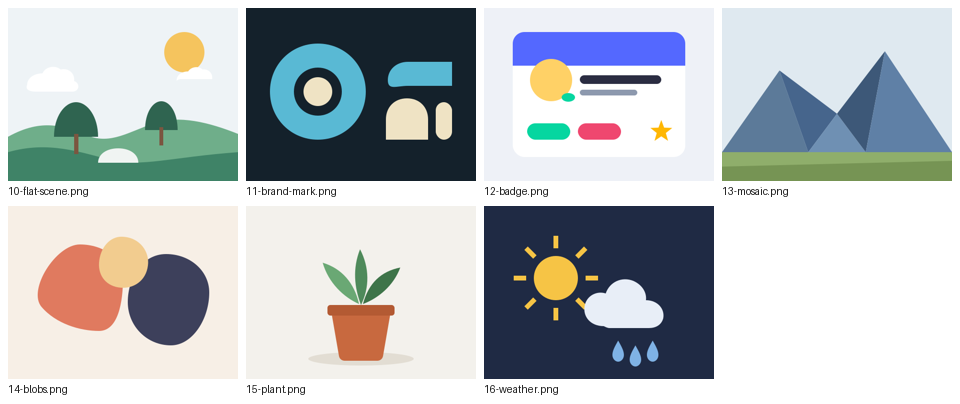
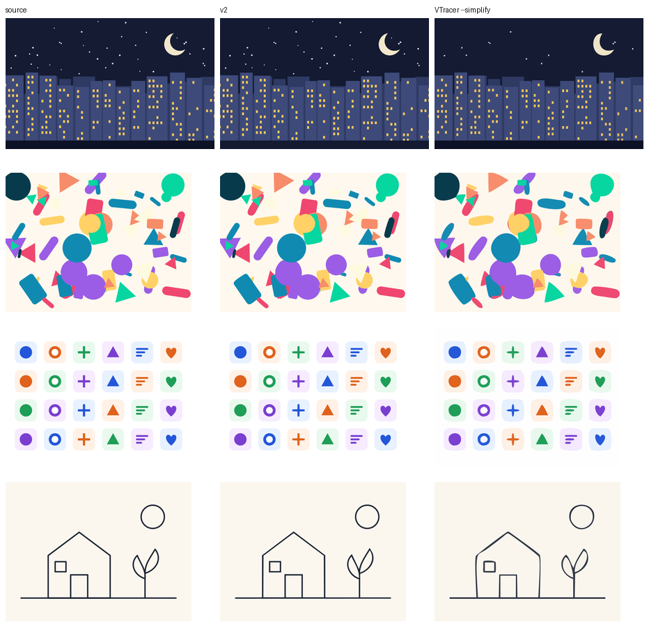
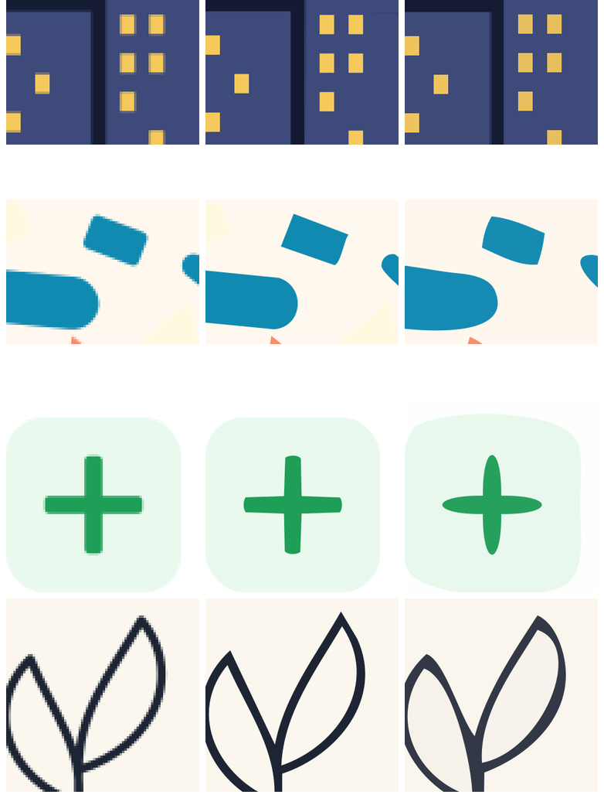
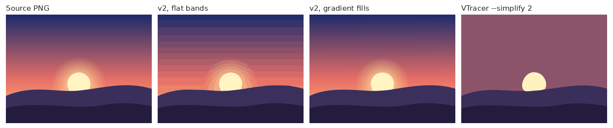
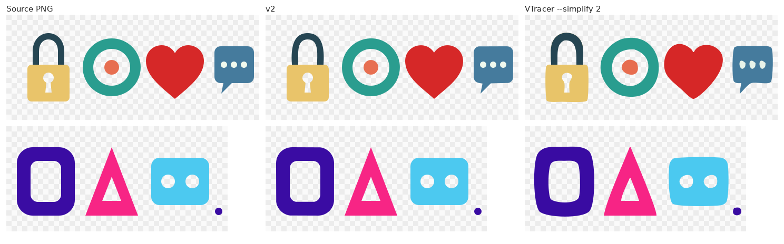
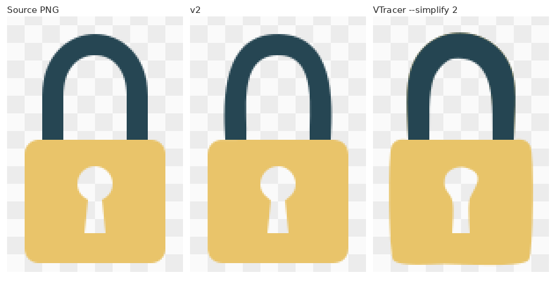

# Benchmarks

All numbers here come from `compare.py`. In its output, `v2` is the
current engine, `v1` is the first version, and `vtracer` / `vtracer-simplify`
are VTracer 1.0 at default settings and with `--simplify 2`.

## Method

The benchmark uses SVG files where the original drawing is known. Each
one is rendered to PNG, the PNG is traced, and the traced SVG is compared
with the original in two ways:

- Anchor points: the number of on-curve points in the output, divided by
  the number in the original. 1.0× means the same count as the original
  drawing. Circles, ellipses and rects count as 4 points; shapes reused
  with `<use>` are counted each time they're drawn. See `vectorlab/metrics.py`.
- Colour error: the output is rendered with cairosvg and compared pixel by
  pixel with the input. This is the mean absolute difference per channel,
  on a 0–255 scale.

The tables also show "agreement", the share of pixels within 32 levels
of the input. It saturates near 100%, so colour error is the better
measure for comparing engines.

An earlier version of the metric counted SVG command letters rather than
anchor points, which made VTracer look about three times worse than it
is. Everything below uses the corrected count.

## Designer fixtures

Seven illustrations drawn for this repo: a flat landscape, a brand mark,
a UI card, a low-poly mosaic, organic blobs, a potted plant and weather
icons.



| Engine | Anchors vs original | Colour error | Worst agreement |
|---|---|---|---|
| v2 | 1.21× | 0.10 | 99.9% |
| VTracer `--simplify 2` | 1.26× | 1.49 | 98.5% |
| VTracer default | 4.10× | 1.15 | 99.1% |
| v1 | 3.77× | 2.42 | 98.4% |

Both tools have a setting that trades points for accuracy, so here they
are across a range of settings. Lower-left is better.


At the same point count (1.13×, v2 at tolerance 1.0 and VTracer at
`--simplify 3`), the colour error is 0.16 for v2 and 1.71 for VTracer.

Source pixels, v2 and VTracer, zoomed in:


## Complex scenes

Six generated scenes, each aimed at a particular weakness: a city at
night with 254 shapes and stars 1.5–2.5 px across, 60 overlapping
confetti shapes, a grid of 24 icons, stroked line art, and two of the
fixtures above rendered at 160 px and 1440 px. They come from
`dataset/generate.py`, which is seeded.



| Engine | Anchors vs original | Colour error | Worst agreement |
|---|---|---|---|
| v2 | 1.22× | 0.65 | 99.4% |
| VTracer `--simplify 2` | 1.39× | 2.20 | 97.1% |



VTracer rounds the plus signs in the icon grid into four-pointed stars,
and fills the leaves in the line art. v2's plus signs have slightly
bulging ends: the bars are 7.7 px wide with a 2 px corner radius, and the
fitted curve stays within the 0.6 px tolerance but is visible when zoomed
in. `--tolerance 0.3` fixes it at the cost of more points.

A seventh scene, a sunset with gradients, is covered in the next section.

## Gradients

The sunset has a sky drawn as a linear gradient, a glow around the sun
drawn as a radial gradient that fades to transparent, and two flat hills.



| Engine | Anchors vs original | Colour error | Agreement |
|---|---|---|---|
| v2 | 1.36× | 0.70 | 100.0% |
| v2 without gradient fills | 16.9× | 2.07 | 99.6% |
| VTracer `--simplify 2` | 1.00× | 18.32 | 72.7% |

Without gradient fills, v2 slices the sky into bands of flat colour.
VTracer flattens the whole sky to one colour and drops the glow.

A gradient has no flat colours, so the palette cuts it into bands. Where
two bands meet inside a gradient, the colour changes across the boundary
by about as much as it does from one pixel to the next inside each band.
At a real edge, even a blurred one, it changes far more. v2 groups bands
joined by boundaries like that, then fits a linear or radial gradient to
the group's pixels, with as few colour stops as it can. If the fit
doesn't reproduce the pixels closely enough, it tries a gradient
underneath with one or more radial glows over it that fade to
transparent. Groups that still don't fit are split in half and tried
again. Bands that can't be explained stay as flat shapes.

On the sunset, the sky comes back as one rectangle with a four-stop
linear gradient, and the glow as a circle with a radial gradient whose
opacity falls from 0.56 to 0 (the original fades from 1 to 0, but the
sun covers the middle).

Random scenes with a linear-gradient rectangle and a radial-gradient
circle (`test_gradients_become_gradient_fills`) come back as three
shapes and 12 anchors, with a mean colour error of 0.2–0.4.

Upscaled or blurred flat artwork doesn't trigger it: the badge fixture
enlarged 3× still traces with no gradient fills.

## Transparent images

Two fixtures are rendered without a background: a set of icons (a
padlock with a keyhole, a ring with a dot inside it, a heart, a speech
bubble) and a logo made of letter-like shapes with holes. Colour error
is measured over white. "Opaque area" is the overlap between the parts
of the input and output that are at least half opaque (intersection
over union).



| Fixture | Engine | Anchors vs original | Colour error | Opaque area |
|---|---|---|---|---|
| Icons | v2 | 0.86× | 0.29 | 99.5% |
| | VTracer `--simplify 2` | 0.86× | 2.63 | 94.1% |
| | VTracer default | 2.92× | 2.23 | 95.0% |
| Logo | v2 | 0.95× | 0.14 | 99.9% |
| | VTracer `--simplify 2` | 0.74× | 2.73 | 93.3% |
| | VTracer default | 3.90× | 1.72 | 95.4% |

v2 composites the image over a key colour picked to be as far as
possible from every colour in the artwork, then traces as usual and
leaves the key colour's regions out of the SVG. Edge pixels that are
partly transparent become blends of the shape's colour and the key, so
they're read the same way as antialiasing. A hole that contains any
transparency is never filled in, and no shape is extended underneath a
transparent area.



The legs of v2's padlock shackle taper slightly. Each leg and its half
of the arc are fitted as one curve, which stays within the 0.6 px
tolerance; `--tolerance 0.3` keeps them straight.

## Real images

Nine images downloaded from the web, each scaled to 1024 px and given to
both tools. There's no original drawing here, so only point count and
colour error are compared. Apart from the mushroom, these images aren't
in the repo because their licences are unknown.

| Image | v2 points | v2 error | VTracer points | VTracer error |
|---|---|---|---|---|
| Clip-art mushroom | 1,044 | 3.51 | 2,944 | 7.61 |
| Vector flower | 2,525 | 2.01 | 5,860 | 3.71 |
| Cartoon mascot | 5,869 | 4.04 | 11,191 | 4.98 |
| Isometric city infographic | 11,893 | 3.56 | 22,921 | 6.42 |
| Low-poly fox | 17,705 | 7.39 | 23,730 | 12.15 |
| Neon gradient blobs | 11,633 | 12.88 | 21,183 | 16.12 |
| Graffiti alphabet | 46,445 | 11.66 | 140,143 | 10.76 |
| Botanical engraving | 21,635 | 21.06 | 192,430 | 18.58 |
| Stained-glass peacock | 41,753 | 16.20 | 144,932 | 13.44 |

v2 is ahead on both counts for the first six. On the last three, which
are mostly texture, VTracer is more accurate. Part of the gap comes from
v2's 6,000-region limit, which the graffiti and the peacock both hit.

Gradient fills brought every image down a little, by 0–11% in points
and 0–10% in error. The neon blobs gained the least for an image made of
gradients: they overlap and blend into each other, so few groups of
bands fit a single linear or radial gradient.

## What each part contributes

Each row turns one part of v2 off and reruns the designer fixtures.

| Turned off | Anchors vs original | Colour error |
|---|---|---|
| nothing | 1.21× | 0.12 |
| reading antialiasing (sub-pixel edges) | 2.34× | 0.12 |
| layering shapes, holes filled | 1.92× | 0.19 |
| blend-aware colour labels | 1.45× | 0.12 |
| extending shapes under the ones on top | 1.29× | 0.14 |
| optimal curve fitting (greedy instead) | 1.23× | 0.14 |
| circle/ellipse/rect primitives | 1.18× | 0.14 |

Sub-pixel edges and layering account for most of the improvement. The
optimal fitting only saves about 2% over a greedy fit. Primitives slightly
increase the count, since a circle counts as 4 points and the fitter can
draw one with 3 curves; they're kept because a circle that stays a circle
is easier to edit.

## Reproducing

```bash
pip install cairosvg "vtracer==1.0.0a4"

python3 dataset/generate.py           # regenerate the complex scenes
python3 dataset.py                    # render every SVG in dataset/svg/ and record ground truth
python3 compare.py --gt-only          # v1, v2 and VTracer on every fixture with ground truth
```

Other engines can be passed with `--engines`, for example
`v2,v2-no-coverage,v2-greedy-fit` for the ablation,
`v2,v2-no-gradients --only 23-` for the gradient comparison, or
`v2-tol-0.4,v2,v2-tol-1.0,vtracer-simplify-1,vtracer-simplify-3` for the
tolerance sweep. Results go to `compare-out/COMPARISON.md`.

### Your own SVGs

Put SVG files in `dataset/external/` (a subfolder name becomes the
category), then:

```bash
python3 dataset/external.py
python3 compare.py --input samples/external --split tune --engines v2,vtracer-simplify
python3 compare.py --input samples/external --split test --engines v2,vtracer-simplify
```

Each SVG is rendered at 1024 px, plus a JPEG copy. The ground truth notes
which features a file uses (strokes, gradients, text, clipping), and the
results are broken down by them. Files that load external resources,
declare XML entities or contain scripts are skipped.

Files are split into a tune set (about 60%) and a test set (about 40%)
by a hash of the filename, so the split never changes. The idea is to
adjust the engine against `tune` and only report `test`. Nothing in
`dataset/external/` is committed.

`dataset/vector_image_to_vector_benchmark/` has a downloader for seven
SVGs from Wikimedia Commons. Run it yourself and `dataset/external.py`
picks them up. They're CC BY-SA 4.0; attribution is in that folder.
